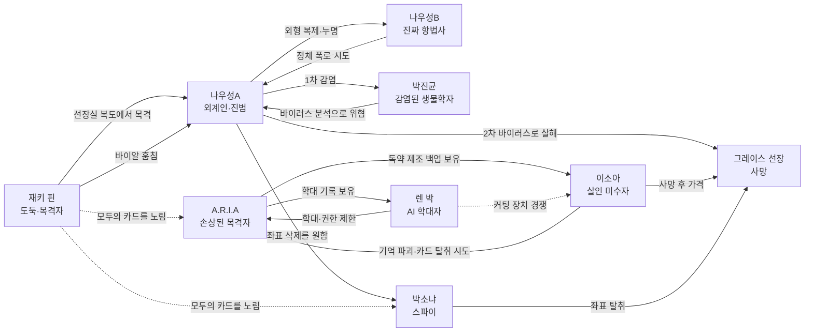

# 헤일메디호 리워크 제안

> 목표: 기존의 외계인·도플갱어·파란 피·삭제된 AI 기억은 유지하면서, 8명 전원의 우승 조건이 서로 얽히게 만든다.

---

## 1. 현재 기획의 강점

- **살인과 공격이 따로 존재**한다. 나우성A가 바이러스로 먼저 살해했고, 이소아가 이미 죽은 선장을 가격했다는 이중 진실이 좋다.
- **나우성 두 명**은 논리 퍼즐과 사회적 신뢰 게임을 동시에 만든다.
- **A.R.I.A의 손상된 기억**은 히든 카드를 공개하는 장치와 서사가 자연스럽게 연결된다.
- 스파이, 도둑, AI 학대자, 살인 미수자가 함께 있어 **범인이 아니어도 모두 거짓말할 이유**가 있다.

## 2. 우선 정리할 충돌

1. 문서별 행동 순서가 다르다. 나우성A 탈출은 4·5·6번, 나우성B 질문은 3·4번으로 혼재한다.
2. `카드_설계.md`는 1인 2장, `인물별_비공개_시트.md`는 1인 3장을 전제로 한다.
3. 렌 박은 문서에 따라 '학대 기억 삭제' 혹은 '지워진 기억 복원'이 목표로 반대다.
4. 대부분의 비범인이 `진범 잡기 2점`을 공유한다. 후반에는 7대 1 협력 구조가 되기 쉽다.
5. `파란 피를 흘리며 발작 중` 인물이 `이미 사망`했다는 표현은 플레이어가 논리 오류로 받아들일 수 있다. `파란 피 = 회복 불가능한 뇌사 단계`, 이후의 움직임은 신경성 경련으로 정의하면 깔끔하다.

---

## 3. 권장 사건 타임라인

### 항해 이전과 1주 차

| 시점 | 사건 | 후에 남는 단서 |
|---|---|---|
| 출항 2개월 전 | 지구 연합은 '탐사'로 위장한 외계 자원 회수 작전을 승인 | 선장의 비밀 명령서 |
| 출항 1개월 전 | 박소냐는 좌표 탈취, 재키 핀은 유물 절도를 목적으로 승선 | 위조 신분·통신 흔적 |
| 승선일 | 진짜 나우성B 포함 8명 승선 | 최초 승선 기록은 나우성 1명 |
| 항해 3일 차 | 나우성A가 외부 해치로 침투, 화물칸에 은신 | 해치 압력 오류 47초 |
| 항해 5~7일 차 | A가 B를 스캔하고 외형·음성을 복제 | B의 손글씨와 오래된 기억은 복제 불가 |

### 2~3주 차

| 시점 | 사건 | 관계 변화 |
|---|---|---|
| 14일 차 | A가 박진균에게 1차 감염을 일으킴 | 박진균은 '나우성'을 의심하지만 A/B를 구분 못 함 |
| 14일 차 | A가 선장에게도 1차 바이러스 노출 | 이소아의 처방 실수처럼 보이는 증상 발생 |
| 16일 차 | 이소아가 독극물을 제조, A.R.I.A가 백업 | 이소아↔A.R.I.A 증거 충돌 시작 |
| 17일 차 | 렌 박이 A.R.I.A 학대 기록을 삭제하려다 선장에게 경고받음 | 렌↔A.R.I.A, 렌↔선장 대립 |
| 18일 차 | A가 B 제거를 시도하지만 B가 소란을 일으켜 실패 | 전원은 '나우성이 두 명'임은 알지만 누가 진짜인지 모름 |
| 20일 차 | 재키가 정체 불명 바이알을 훔침 | A는 재키의 도둑 정체를 폭로할 수 있고, 재키는 A의 정체를 폭로할 수 있음 |
| 20일 차 | 박소냐가 비밀 좌표의 위치를 확인 | 선장 사망이 탈취 기회가 됨 |

### 사건 3일 전

| 시각 | 사건 |
|---|---|
| 16:00 | 이소아가 독이 든 음료를 권하지만 선장이 거절 |
| 18:20 | 선장이 렌 박에게 AI 접근권 회수를 통보 |
| 20:10 | B가 도플갱어에 대해 보고하려 하지만 선장이 접견을 거부 |
| 23:40 | 선장이 외계 자원 강탈 명령서와 좌표를 따로 분리해 숨김 |

### 사건 전날 밤

| 시각 | 인물 | 사건 | 발견 가능한 반쪽 진실 |
|---|---|---|---|
| 21:00 | A | 함교에 점검 기록을 미리 생성 | 기록은 있지만 생체 인증이 없음 |
| 21:40 | 이소아 | 독성 주사기를 소지하고 의료 구역을 이탈 | 살의는 있었지만 실제 주입은 안 함 |
| 21:52 | 박소냐 | 비밀 통신을 위해 통신실 출입 기록을 수동 중지 | 22시대 알리바이가 비어 보임 |
| 21:58 | 박진균 | 두통으로 의료 구역을 찾았다가 빈 실험대를 봄 | 이소아의 이탈을 숨기면 자신의 감염도 숨겨짐 |
| 22:00 | A | 함교 이탈, 선장실로 이동 | 15분의 기록 공백 |
| 22:08 | 재키 | 선장실 복도에서 A가 나오는 모습을 목격 | '나우성'은 봤지만 A/B 구분은 못 함; 자신의 절도 동선 때문에 숨김 |
| 22:10 | A | 선장에게 2차 바이러스 주입 후 도주 | 직접 사인 |
| 22:15 | A | 함교 복귀 기록 생성 | 21:00~22:15 연속 점검처럼 위조 |
| 22:18 | 선장 | 파란 혈액 발현, 뇌 기능 회복 불가 단계에 진입 | 의학적 사망 시각 |
| 22:20 | A.R.I.A | 선장실 이상 생체신호를 감지하지만 렌의 이전 권한 제한으로 구조 프로토콜 실패 | 렌은 살인범은 아니지만 사망을 막을 수 있었음 |
| 22:30 | 이소아 | 선장실 진입. 파란 피와 신경성 경련을 보고 유리잔으로 가격 | 살인 미수·사체 훼손이지만 살인은 아님 |
| 22:35~22:50 | 이소아·A.R.I.A | 이소아가 AI 기억을 손상. 가격 기억은 삭제, 독약 제조 백업은 잔존 | 기억 파일과 관리자 카드가 만나야 복원 가능 |
| 23:30 | 재키 | 혼란을 틈타 추가 절도 | 살인 이후의 동선이지만 도둑 증거 |

### 사건 당일

| 시각 | 사건 |
|---|---|
| 06:30 | A.R.I.A가 22:35~22:50 기억 공백과 별도 백업 존재를 감지 |
| 07:00 | 이소아가 백업 파일을 마저 지우기 위해 기억 커팅 장치를 찾기 시작 |
| 07:20 | 렌 박이 자신의 학대 기록을 지우려 같은 장치를 찾기 시작 |
| 08:20 | 시신과 복도의 외장 기억장치 발견 |
| 09:00 | 탐사·거래·추리 시작 |

---

## 4. 관계도

관계도의 핵심은 `A→B→재키→A`, `A.R.I.A→이소아↔렌 박→A.R.I.A`, `좌표→박소냐↔나우성A`의 세 개 충돌 고리다.

---

## 5. 서로 얽히는 우승 조건 개편안

### 공통 원칙

- 전원 만점은 **5점**으로 통일한다.
- `진범 지목`은 대부분에게 1점만 준다. 범인 검거만으로 개인 승리가 보장되지 않게 한다.
- 각 인물은 `공개 명분 1개 + 비밀 목표 2개`를 갖는다.
- 성공 조건은 다른 인물의 소지품이나 협조를 최소 1번 필요로 한다.

| 인물 | 추천 우승 조건 | 충돌하는 상대 |
|---|---|---|
| **박진균** | 치료제로 자신을 치료 2 / 바이알+분석서를 함께 공개 2 / 진범 지목 1 | 바이알을 지키려는 재키, 샘플을 파괴할 A |
| **나우성A** | 외계인 정체 비공개 2 / 탈출 2 / 좌표 카드를 파괴하거나 위조 좌표로 교체 1 | B, 박진균, 박소냐, 재키 |
| **박소냐** | 좌표 전송 2 / 스파이 신분 비공개 1 / 나우성A가 탈출하기 전 생체 신호 코드를 함께 전송 2 | 좌표를 파괴할 A, 카드를 훔칠 재키. 단 A와 일시 공조도 가능 |
| **나우성B** | 2명 이상에게 진짜로 인정 2 / A 구속 2 / 자신의 손글씨 증거 유지 1 | A, 증거를 훔칠 재키, 질문에 거짓 답할 협상자 |
| **A.R.I.A** | 기억 복원 2 / 학대 기록 공개 2 / 사망 시각 22:18을 밝힘 1 | 이소아, 렌 박. 단 이소아와는 진범 규명을 위한 일시 공조 가능 |
| **이소아** | 최종 투표 2표 이하 2 / 독약 제조 백업 삭제 2 / 실제 사인을 바이러스로 확정 1 | A.R.I.A, 렌 박. 단 A.R.I.A가 사인을 밝혀야 자신이 살인범에서 벗어남 |
| **재키 핀** | 외계 사치품 2종 2 / 바이알을 게임 종료까지 유지 2 / 도둑으로 최종 지목되지 않음 1 | A, 박진균, 카드가 필요한 전원 |
| **렌 박** | 학대 기억 삭제 2 / AI 관리자 권한 유지 1 / A.R.I.A가 이소아의 백업을 공개하게 만듦 2 | A.R.I.A, 이소아. 이소아의 비밀을 미끼로 자신의 학대를 숨길 수 있음 |

### 이 구조에서 생기는 좋은 배신

- 박진균은 진범을 증명하려면 재키의 바이알이 필요하지만, 공개하면 재키는 2점을 잃는다.
- 이소아는 A.R.I.A의 기억을 지워야 2점을 얻지만, A.R.I.A의 사망 시각 기록이 공개되어야 살인 혐의에서 벗어난다.
- 렌 박과 이소아는 같은 1회용 기억 커팅 장치를 원하지만, 렌은 이소아의 기억이 공개되어야 추가 점수를 얻는다.
- 박소냐는 A의 생체 정보까지 보내면 큰 점수를 얻지만, A가 좌표 파괴를 원하기 때문에 협력 직전에 서로 배신할 수 있다.
- B는 자신이 진짜임을 인정받기 위해 표를 거래하게 되고, 그 결과 범인 투표가 흐트러질 수 있다.
- 재키는 증거를 줄 수 있지만, 바로 그 증거가 자신의 범죄를 확정한다.

---

## 6. 카드 충돌망

| 핵심 카드 | 갖고 싶은 인물 | 공개하고 싶은 인물 | 없애고 싶은 인물 |
|---|---|---|---|
| 정체 불명 바이알 | 재키, 박진균 | 박진균, B | A |
| 외계 좌표 | 박소냐 | 실제 임무를 밝히려는 A.R.I.A | A |
| A.R.I.A 행동 백업 | A.R.I.A, 렌 박 | A.R.I.A, 렌 박 | 이소아 |
| A.R.I.A 학대 기록 | A.R.I.A | A.R.I.A | 렌 박 |
| AI 관리자 카드 | 렌 박, A.R.I.A, 이소아 | A.R.I.A | 렌 박은 필요할 때만 제시 |
| 기억 커팅 장치 | 렌 박, 이소아 | 없음 | 사용되기 전 A.R.I.A |
| 나우성B 서명지 | B | B, 박진균 | A, 재키 |
| 긴급 탈출 코드 | A | B, 수갑 소지자 | 탈출을 막으려는 전원 |

카드를 단순히 '공개/비공개'만 하지 말고, **소지·공개·사용·파괴**를 따로 판정하면 거래와 배신이 살아난다.

---

## 7. 권장 게임 흐름

1. **프롤로그·공개 소개 (10분)** — 나우성이 두 명이라는 사실은 처음부터 공개한다.
2. **1차 탐사 (20분)** — 알리바이·의료 증거 중심. 플레이어들은 이소아와 두 나우성을 의심한다.
3. **1차 비밀 거래 (10분)** — 2인 밀담 허용. 카드는 보여주거나 양도할 수 있다.
4. **2차 탐사 (20분)** — 바이러스·이중 승선 기록·AI 기억 단서 투입.
5. **중간 사건 (5분)** — 박진균의 피가 보라색으로 변하고 시간 제한이 선언된다. 치료제 가치가 급상승한다.
6. **2차 비밀 거래 (10분)** — 좌표, 바이알, 기억 장치 소유권이 변경된다.
7. **최종 증언 (1인 1분)** — 각자 한 문장은 반드시 진실, 한 문장은 자유 발언.
8. **동시 투표** — 살인범 1명과, 선택으로 '가장 숨긴 것이 많은 인물' 1명을 지목한다.
9. **마지막 행동 동시 선언** — 신고나 눈치로 순서가 노출되지 않게 행동 카드를 뒤집어 제출한다.
10. **해결·개인 엔딩 (15분)** — 총점이 같으면 '최대 비밀 목표 달성 수'로 우승자를 가린다.

### 마지막 행동 우선순위 고정안

1. 재키 — 훔치기
2. 렌 박 — 기억 커팅/권한 잠금
3. 이소아 — 기억 커팅
4. 치료제 소지자 — 치료
5. 박소냐 — 좌표 전송
6. 나우성B — 정체 증언 요청
7. 수갑 소지자 — 구속
8. 나우성A — 탈출

`A의 탈출을 마지막`으로 두면, 수갑·절도·전송·치료의 결과가 모두 탈출 성공 여부에 반영된다.

---

## 8. 플레이 테스트 체크리스트

- 8명 중 최소 5명이 3점 이상을 얻을 수 있는가?
- 어떤 인물도 탐사 운에 의해 주요 목표가 자동 실패하지 않는가?
- 핵심 증거 1장이 사라져도 A를 지목할 독립 경로가 2개 이상 남는가?
- A가 초반에 정체를 들켜도 탈출·좌표 파괴로 역전할 수 있는가?
- 이소아가 살인범으로 오인받아도 플레이어가 '잘못 설계된 함정'이 아니라 '내가 감수한 거짓말의 결과'로 받아들일 수 있는가?
- 렌 박과 재키가 살인 추리에도 참여할 정보·유인이 있는가?
- 비밀 거래가 최소 3회, 배신이 최소 1회 발생하는가?

---

## 9. 다음 편집 순서

1. 이 문서의 타임라인과 행동 순서를 정사로 확정
2. 8인 비공개 시트의 점수·행동 순서 일괄 교체
3. 카드 수를 `소지품 24 + 탐사 12 + 히든 2`로 확정하거나, 인물 소지품을 2장으로 축소
4. 증거별 `소지/공개/사용/파괴` 규칙 추가
5. 1회 테스트 후 점수보다 '누가 누구와 거래했는지'를 기록해 관계 충돌을 조정
