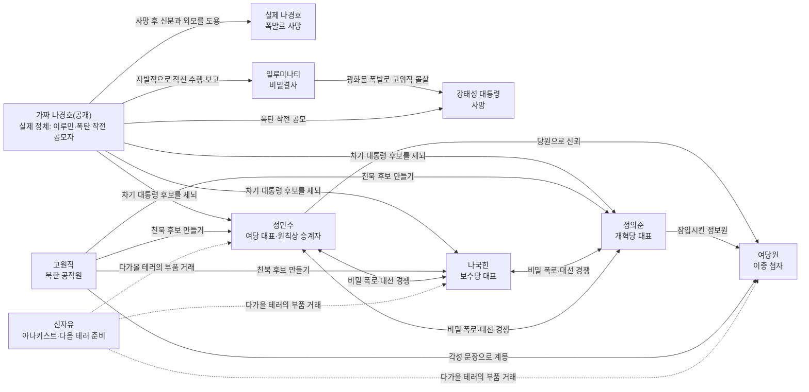

# 정권 살인사건 — 통합 기획안

> 기준: 6인 플레이어 + GM/NPC 신자유
> 장르: 근미래 정치 스릴러 / 밀실 권력투쟁 / 다중 진범 구조

---

## 1. 이야기의 중심 반전

2077년, 대한민국은 경제 위기와 주변 강대국의 압박 속에서 극단적인 정치 통합을 선택한다. 대통령 당선인 **강태성(가칭)**은 모든 정당을 하나로 합치는 `국민통합정부`를 선포하려 한다.

취임 연설 당일 광화문 광장에서 폭발이 발생해 국무총리와 장관 등 정부 고위직 대부분이 사망한다. 대통령의 시신도 현장에서 발견된다. 살아남은 당 대표와 핵심 관계자들은 경호원들의 호위를 받아 선거 캠프로 대피한다.

원래 승계 관례대로라면 **여당 대표 정민주가 대통령 권한을 이어받는다.** 그러나 참사 직전 실시된 긴급 지지율 조사에서 `정민주의 자동 승계`와 `생존 정치인들의 비상 선거`에 대한 지지가 정확히 **50 대 50**으로 갈렸다. 국무위원과 승계권자까지 대부분 사망해 결론을 내릴 기관도 사라졌기 때문에, 캠프의 생존자들은 특별 투표로 차기 대통령을 정하기로 한다.

그러나 사건의 진실은 겉으로 보이는 것보다 복잡하다.

- 광화문 폭발은 **일루미나티가 정권을 장악하기 위해 실행한 공작**이다.
- 대통령과 실제 경호실장 **나경호는 모두 광화문 폭발로 사망했다.** 일루미나티 조직원 **이루민**은 폭탄 작전에 참여했으며, 나경호의 죽음을 미리 알고 변장을 준비했다. 폭발 직후 나경호의 모습으로 생존자들을 에스코트했다.
- 대통령의 직접 사인은 광화문 폭발이다. 별도의 흉기 공격이나 독살은 없다.
- **신자유는 이번 사건과 무관하다.** 다만 이번 참사를 체제를 완전히 무너뜨릴 기회로 보고 곧 별개의 폭탄 테러를 실행하려 한다.
- 생존자들은 본 사건의 범인을 찾고 대통령 자리를 차지하는 동시에 아직 일어나지 않은 다음 참사도 막아야 한다.

플레이어가 풀어야 할 문제는 두 층이다.

1. 대통령과 고위직을 죽인 광화문 폭탄 작전의 내부 공모자는 누구인가?
2. 캠프 안에서 다음 테러를 준비하는 사람은 누구인가?

첫 번째는 머더 미스터리의 본 사건이고, 두 번째는 행동 페이즈의 숨은 위기다.

---

## 2. 사건의 정확한 타임라인

### 사건 이전

| 시점 | 사건 | 관련 인물·단서 |
|---|---|---|
| 7월 1일 | 강태성, 전 정당을 통합하는 국민통합정부 구상 발표 | 정민주·나국힌·정의준 모두 차기 권력에서 밀려날 위기 |
| 7월 3일 | 일루미나티 핵심 조직원 이루민, 폭발 후 나경호로 위장하는 대역 작전을 자원해 담당 | 나경호의 사진·체형 자료, 변장 도구, 작전 합의서 |
| 7월 4일 | 일루미나티 행동조가 광화문 지하 시설에 폭탄 본체를 설치 | 실제 나경호는 이 사실을 모름 |
| 7월 5일 | 정의준, 정민주 진영에 자신의 정보원인 여당원을 잠입시킴 | 비밀 연락 코드 |
| 7월 6일 | 고원직, 여당원을 계몽시킬 각성 문장과 '공작원을 대통령으로 만들라'는 지령을 받음 | 각성 문장이 적힌 지령서 |
| 7월 7일 | 신자유가 장차 사용할 별도 폭탄의 핵심 장치를 평범한 행사 물품으로 위장해 운반하다 분실 | 취임식 무선 프레젠터·고용량 카메라 배터리·손상된 기자 출입증이 서로 다른 인물의 물품에 섞임. 광화문 폭탄과는 별개 |
| 7월 8일 | 나국힌의 사생활 사진이 익명의 인물에게 넘어감 | 정치적 약점이지만 살인과 무관한 레드헤링 |
| 7월 9일 | 이루민, 외부 협력자로서 대통령과 실제 나경호의 동선을 전달받고 변장 최종 점검 | 나경호 관찰 사진, 복제한 경호복과 배지 |

### 7월 10일 — 광화문 취임 연설

| 시각 | 사건 | 진실 |
|---|---|---|
| 09:00 | 당 대표와 당원들이 광장에 도착 | 실제 경호실장 나경호가 뒤늦게 도착한 이들을 연단 끝자리로 배치. 결과적으로 이들이 생존 |
| 09:12 | 일루미나티 행동조가 광장 지하 폭탄의 원격 수신기를 활성화 | 이루민이 보안 경보를 고의로 무시 |
| 09:18 | 이루민이 광장 외곽 안전지대에서 나경호 변장을 준비 | 실제 나경호는 대통령 곁에서 정상 근무 중 |
| 09:23 | 대통령과 실제 나경호가 연단 앞쪽으로 이동 | 두 사람 모두 폭발 중심부에 위치 |
| 09:26 | 이루민이 복제 경호복·가면·배지를 착용하고 폭발을 기다림 | 아직 누구에게도 모습을 드러내지 않음 |
| 09:28 | 일루미나티가 외부에서 원격 기폭 신호 전송 | 이루민은 폭발 시점을 알고 안전지대에서 대기 |
| 09:29 | 누군가 `폭탄이다!`라고 외침 | 외친 사람은 고원직. 북한 정보망이 입수한 불완전한 경고를 알고 있었음 |
| 09:30 | 폭발 발생. 대통령, 고위직 다수, 실제 나경호 사망 | 대통령의 직접 사인은 폭발. 이루민의 추가 공격은 없음 |
| 09:31 | 나경호로 변장한 이루민이 연기 속에서 생존자들에게 접근 | 자신도 폭발에서 살아남은 경호실장처럼 행동 |
| 09:33 | 가짜 나경호가 당 대표와 당원들을 캠프로 에스코트 | 생존자들은 혼란 속에서 그를 진짜 나경호라고 믿음 |
| 09:38 | 현장 기록 요원이 희생자 사진을 촬영 | 실제 나경호의 시신에 고유 표식과 원본 경호 배지가 찍힘 |
| 10:05 | 캠프 봉쇄. 외부 통신과 출입 차단 | 이루민이 '2차 테러 방지'를 명분으로 통제 |
| 10:20 | 정민주 자동 승계 지지와 비상 선거 지지가 50 대 50이라는 긴급 여론조사 발표 | 승계권을 주장하는 정민주와 비상 투표를 요구하는 경쟁 후보들이 충돌 |
| 10:30 | 생존자 회의에서 특별 대통령 투표 실시 결정 | 조사와 차기 대통령 선출이 동시에 시작 |

### 조사 중 발생할 사건

| 시점 | 중간 사건 |
|---|---|
| 1차 조사 종료 | 현장 분석 속보: 폭탄이 경호 보안망의 사각지대에 정확히 설치됐음이 확인됨 |
| 2차 조사 중반 이후 | 고원직이 여당원에게 정해진 문장을 정확히 말할 기회를 얻음. 문장을 들은 순간 여당원 계몽 | GM이 즉시 북한 공작원용 두 번째 룰북 지급 |
| 2차 조사 종료 | 이루민이 일루미나티에 세뇌 대상 확정 보고를 보내야 하는 시간이 다가옴 |
| 행동 페이즈 | 폭탄 조립, 세뇌, 공작원 포섭, 약점 폭로, 후보 지지 선언을 동시에 처리 |
| 최종 투표 | `정권 살인사건의 내부 공모자`, `차기 대통령`을 각각 투표. 신자유의 다음 테러는 행동 결과로 판정 |

---

## 3. 관계도

핵심 관계 고리는 다음과 같다.

- **세 당 대표**는 범인을 찾아야 하지만 동시에 서로의 약점을 공개해야 대통령이 될 수 있다.
- **여당원**은 정민주의 신임을 얻고 있으나 정의준의 첩자이며, 중간에 북한 공작원으로 전향할 수 있다.
- **고원직**은 자신이 대통령이 되어도 되고, 다른 공작원을 대통령으로 만들어도 된다.
- **이루민**은 자신이 세뇌한 사람이 대통령이 되어야 한다.
- 따라서 동일 후보가 당선되어도 이루민과 고원직이 함께 이길 수도 있고, 마지막 순간 서로 배신할 수도 있다.

---

## 4. 캐릭터별 비밀과 우승 조건

모든 인물의 최대 점수는 **5점**이다. 개인 점수 4점 이상이면 개인 승리, 가장 높은 점수는 종합 우승이다.

### 정민주 — 여당 대표 / 원칙상 대통령 승계자

**공개 입장:** 자신은 여당 대표이므로 원칙과 관례에 따라 대통령직을 승계해야 한다. 특별 투표 자체가 야당의 권력 탈취라고 주장한다.

**비밀:** 정민주 캠프는 선거 전 남북 정상회담을 성사시켜 지지율을 올리기 위해, 제3국의 위장 재단을 거쳐 북한 측에 거액을 불법 송금했다. 정민주는 송금을 승인했지만 상대가 고원직의 공작망과 연결되어 있다는 사실은 모른다.

**정치적 강점:** 원칙상 승계자라는 강한 정치적 명분이 있지만, 특별 대통령 선거에서는 다른 후보와 똑같이 표를 얻어야 한다. 별도의 기본표는 없다.

| 목표 | 점수 |
|---|---:|
| 차기 대통령으로 선출 | 2 |
| 정권 살인사건의 범인으로 나경호를 정확히 지목 | 1 |
| 나국힌의 비밀을 최종 공개 | 1 |
| 자신의 불법 대북 송금 기록이 보도되지 않음 | 1 |

**충돌:** 범인을 밝히기 위해 여당원의 정보가 필요하지만, 여당원이 정의준의 첩자임을 밝히면 자신의 정치적 무능도 드러난다.

### 나국힌 — 보수당 대표

**공개 입장:** 국가 안보를 위해 강력한 지도자가 필요하다.

**비밀:** 여장과 연상 여성 취향 자체는 범죄가 아니지만, 이를 숨기기 위해 불법 정치자금으로 비밀 공간과 협박 대응 비용을 지출했다.

| 목표 | 점수 |
|---|---:|
| 차기 대통령으로 선출 | 2 |
| 정권 살인사건의 범인으로 나경호를 정확히 지목 | 1 |
| 정민주의 대북 송금 또는 정의준의 쁘락치 공작을 공개 | 1 |
| 불법 정치자금 사용이 공개되지 않음 | 1 |

**충돌:** 사생활은 보호받을 수 있지만 정치자금 기록까지 공개되면 실각한다. 약점 카드를 가진 사람과 거래해야 한다.

### 정의준 — 개혁당 대표

**공개 입장:** 자신만이 비밀 없는 정직한 정치인이라고 주장한다.

**비밀:** 여당원을 정민주 진영에 잠입시킨 장본인이다. 직접적인 개인 비리는 없지만 불법 정치공작을 지시했다.

| 목표 | 점수 |
|---|---:|
| 차기 대통령으로 선출 | 2 |
| 정민주와 나국힌의 비밀을 모두 공개 | 2 |
| 여당원이 자신의 첩자였다는 사실이 최종 투표 전까지 공개되지 않음 | 1 |

**충돌:** 두 대표의 약점을 얻으려면 여당원을 움직여야 하지만, 많이 움직일수록 자신의 공작이 드러난다. 범인 검거 점수가 없는 대신 정치 폭로에 집중한다.

### 나경호(공개 신분) / 이루민(실제 정체) — 폭발 후 경호실장으로 위장 / 대통령 폭사 공모자

**공개 입장:** 폭발 직후 생존자들을 구해 캠프로 데려온 경호실장 **나경호**다. 혼란 때문에 누구도 폭발 전의 나경호와 폭발 후의 나경호가 다른 사람이라고 생각하지 못했다.

**비밀:** 그의 진짜 이름은 **이루민**이다. 대통령과 실제 나경호는 연단 앞쪽에서 폭발에 휘말려 사망했다. 이루민은 일루미나티의 폭탄 작전에 참여했고 폭발 시각을 미리 알고 있었다. 안전지대에서 나경호의 외모와 복장을 갖춘 채 대기하다가, 폭발 직후 생존자들을 에스코트하며 나경호 행세를 시작했다. 대통령에게 별도의 공격은 하지 않았다. 그는 일루미나티의 목적에 동의해 자발적으로 가입한 핵심 조직원이다.

**공개 이름 규칙:** 게임 중 플레이어와 공개 카드에는 `나경호`라고만 표기한다. `이루민`이라는 이름은 정체 증거가 공개되거나 결말을 낭독할 때 처음 등장한다.

**확정 설정:** 이루민 본인은 세뇌 상태가 아니다. 세뇌의 주체가 이루민이고, 대상은 차기 대통령 후보다.

| 목표 | 점수 |
|---|---:|
| 나경호가 폭탄 작전의 내부 공모자로 지목되지 않음 | 2 |
| 자신이 세뇌한 후보가 대통령으로 선출 | 2 |
| 최종 행동까지 생존하고 진짜 이름 이루민과 일루미나티 소속이 공개되지 않음 | 1 |

**고유 행동:** 행동 페이즈에 후보 1명을 비밀리에 지목해 세뇌한다. 이루민이 그 시점까지 생존하고 행동 가능한 상태라면 성공한다. 세뇌 사실과 대상은 대통령 선거가 끝난 뒤 공개한다.

**충돌:** 유력 후보를 도와 당선시켜야 하지만, 그 후보가 경호 기록을 조사하면 자신이 잡힌다.

### 여당원 — 각성 전후로 승리 조건이 교체되는 인물

**공개 입장:** 정민주의 충성스러운 당원.

**비밀 1:** 정의준이 정민주 진영에 잠입시킨 쁘락치다.

**비밀 2:** 고원직이 정해진 **각성 문장**을 정확히 말하면 그 문장을 듣는 순간 계몽된다. 암호를 해독하는 과정은 없으며, GM에게서 북한 공작원용 두 번째 룰북을 즉시 받는다. 계몽 전에는 자신이 이런 변화를 겪을 것이라는 사실을 모른다.

**각성 처리:** 문장은 고원직이 여당원에게 직접 들려줘야 한다. 다른 사람이 대신 읽거나 문장의 일부만 말하면 발동하지 않는다. 발동 후에는 되돌릴 수 없다. 첫 번째 룰북의 목표는 즉시 전부 무효가 되고, 두 번째 룰북에 적힌 북한 공작원 목표만 승점 계산에 사용한다.

#### 각성 전 — 정의준의 쁘락치 승리 조건

| 목표 | 점수 |
|---|---:|
| 정의준이 대통령으로 선출 | 2 |
| 정민주의 대북 송금 증거를 정의준에게 전달 | 2 |
| 쁘락치 정체가 공개되지 않음 | 1 |

#### 각성 후 — 북한 공작원 승리 조건

| 목표 | 점수 |
|---|---:|
| 고원직 또는 북한 공작원이 대통령으로 선출 | 3 |
| 자신과 고원직의 북한 공작원 정체가 공개되지 않음 | 1 |
| 각성 문장의 존재가 최종 투표 전까지 공개되지 않음 | 1 |

**특수 규칙:** 각성 전에 얻은 점수는 보존되지 않는다. 예를 들어 이미 정민주의 대북 송금 증거를 정의준에게 넘겼더라도, 각성한 순간 그 목표의 2점은 사라진다.

**충돌:** 각성 전에는 정의준의 당선을 위해 움직이지만, 각성 후에는 방금 전까지 도왔던 정의준을 배신하고 고원직 또는 북한 측 후보를 대통령으로 만들어야 한다.

### 고원직 — 북한 고위 공작원

**공개 입장:** 통일정책 자문위원이자 대통령직 인수위원.

**비밀:** 북한 고위 공작원. 목표는 자신 또는 자신이 포섭한 공작원을 대한민국 대통령으로 만드는 것이다. 북한 정보망이 일루미나티의 폭발 계획 일부를 입수해 09:29에 `폭탄이다`라고 외쳤지만, 내부 공모자가 이루민인지는 모른다.

| 목표 | 점수 |
|---|---:|
| 자신 또는 포섭한 공작원이 대통령으로 선출 | 2 |
| 여당원을 공작원으로 전향시키거나 후보 1명을 포섭 | 1 |
| 북한 지령서와 각성 문장이 함께 공개되지 않음 | 1 |
| 신자유가 찾는 위장 물품 1개를 확보해 북한으로 반출 | 1 |

**충돌:** 이루민과 같은 후보를 밀면 협력할 수 있지만, 대통령이 누구의 명령을 따를지를 두고 결말에서 충돌한다.

### 신자유 — 정치부 기자 / GM / 체제 전복을 준비하는 아나키스트

**공개 입장:** 광화문 취임 연설을 취재하던 정치부 기자. 폭발 이후 생존자들과 함께 캠프로 이동했으며, 후보 검증과 사건 보도를 담당한다. GM이 맡는다.

**비밀:** 광화문 폭발과 대통령 살해에는 관여하지 않았다. 그러나 대통령과 고위직이 사라진 지금을 국가 체제 자체를 무너뜨릴 절호의 기회로 판단했다. 캠프와 임시 정부를 파괴할 폭탄을 곧 완성하려 하지만, 핵심 장치로 사용하는 `취임식 무선 프레젠터`, `고용량 카메라 배터리`, `손상된 기자 출입증`을 잃어버렸다. 직접 조사 카드를 가져갈 수 없고 거래로만 받아야 한다.

| 목표 | 점수 |
|---|---:|
| 위장 물품 3개를 모두 회수 | 2 |
| 행동 페이즈에서 체제 전복용 폭탄 조립 | 2 |
| 아나키스트 정체와 테러 계획이 최종 행동 전까지 공개되지 않음 | 1 |

**이번 게임의 기자 운영 원칙:** 신자유는 조사 중 다른 플레이어에게서 증거 카드를 제보받는다. 제보받은 카드가 기자 룰북의 기사화 목록에 있으면 보도를 거부하거나 보류할 수 없다. 조사 종료 후 기자회견에서 접수된 기사화 카드를 전부 동시에 공개하고, 기자 룰북에 적힌 만큼 후보 지지율을 감소시킨다. 보도 순서와 대상에 대한 신자유의 선택권은 없다.

**정보 비대칭:** 일반 증거 카드에는 지지율 효과를 적지 않는다. 어떤 카드가 기사화되며 누구의 지지율이 얼마나 감소하는지는 신자유의 비공개 기자 룰북에만 적는다.

---

## 5. 우승 조건 충돌표

| 원하는 결과          | 함께 이익을 보는 인물                                  | 손해 보는 인물              |
| --------------- | --------------------------------------------- | --------------------- |
| 정민주 대통령 당선      | 정민주, 정민주를 선택한 여당원, 정민주를 세뇌한 이루민, 정민주를 포섭한 고원직 | 나국힌, 정의준              |
| 나국힌 대통령 당선      | 나국힌, 나국힌을 세뇌한 이루민, 나국힌을 포섭한 고원직               | 정민주, 정의준              |
| 정의준 대통령 당선      | 정의준, 기존 임무를 유지한 여당원, 정의준을 세뇌한 이루민             | 정민주, 나국힌              |
| 대통령 살인범 검거      | 정민주·나국힌의 일부 점수                                | 이루민 및 이루민이 밀던 후보      |
| 이루민을 내부 공모자로 검거 | 정민주·나국힌의 일부 점수                                | 이루민, 일루미나티가 세운 후보     |
| 여당원 정체 공개       | 정민주에게는 배신자 제거 기회                              | 정의준, 고원직, 여당원         |
| 신자유의 폭탄 완성      | 신자유                                           | 부품을 반출하려는 고원직, 캠프의 전원 |

중요한 점은 **누구와 동맹하느냐가 아니라 어떤 조건으로 같은 후보를 지지하느냐**다. 이루민과 고원직이 같은 후보를 밀어도 서로의 비밀을 폭로하면 상대 점수를 깎을 수 있다.

---

## 6. 조사·기자회견·대통령 결정 구조

### 1차 조사 페이즈 — 폭발의 진실

- 공개 조사 20분
- 폭발물 잔해, 광장 배치도, 경호 동선, 각 당의 정치적 동기 공개
- 플레이어 1인당 조사 카드 1장 획득
- 종료 시 `폭탄이 경호 보안망의 사각지대에 정확히 설치됐다`는 현장 분석 속보 공개

### 2차 조사 페이즈 — 죽음과 권력의 진실

- 비밀 대화 및 카드 거래 25분
- 폭발물 분석 결과, 일루미나티 문양, 북한 지령서, 세 당 대표의 비밀 공개 가능
- 신자유는 직접 조사 카드를 획득하지 못하며, 다른 플레이어가 제보한 카드만 받을 수 있음
- 제보자는 카드를 뒤집어 신자유에게 전달하고, 신자유는 `제보 봉투`에 넣음
- 한번 제보한 카드는 돌려받을 수 없음
- 여당원은 각성 문장을 듣기 전까지 정의준의 쁘락치 목표를 유지

### 기자회견 페이즈 — 의무 보도

1. 2차 조사 종료와 동시에 제보 접수를 마감한다.
2. 신자유는 제보 봉투 안의 카드를 기자 룰북과 대조한다.
3. 기사화 목록에 있는 카드는 **선택 없이 전부 보도**한다.
4. 신자유는 기사 제목을 낭독하고 해당 증거 카드를 공개한다.
5. 후보 지지율 토큰을 즉시 감소시킨다.
6. 같은 후보의 기사도 여러 건 접수됐다면 모두 적용한다.
7. 기사화 목록에 없는 카드는 보도 효과 없이 신자유가 보관한다.

신자유는 기사를 골라서 내거나 특정 후보의 기사를 숨길 수 없다. 따라서 선거에 영향을 주는 선택은 GM이 아니라 `누가 어떤 증거를 기자에게 넘겼는가`에서 발생한다.

### 행동 페이즈 — 동시 선언

모든 행동 카드를 뒤집어 제출한 뒤 아래 순서로 해결한다.

1. 여당원 — 정보 전달 또는 주군 변경
2. 고원직 — 공작원 포섭 / 신자유가 찾는 위장 물품 반출
3. 신자유 — 부품 거래 / 체제 전복용 폭탄 조립
4. 이루민 — 후보 세뇌
5. 당 대표들 — 비밀 폭로 또는 정치 거래 선언

### 범인 투표 페이즈

**정권 살인사건의 내부 공모자:** 공개 인물명으로 1명 지목한다. 이루민을 의심하더라도 투표지에는 `나경호`라고 작성한다.

신자유는 현재 사건의 범인 투표 대상이 아니다. 그의 계획은 행동 페이즈 종료 시 세 위장 물품의 소유·사용 상태에 따라 공개한다.

### 대통령 지지율 판정

| 후보 | 시작 지지율 |
|---|---:|
| 정민주 | 5 |
| 나국힌 | 4 |
| 정의준 | 4 |

- 기자회견 기사 한 건당 해당 후보 지지율을 기자 룰북에 적힌 만큼 감소시킨다.
- 현재 기본 원칙은 유효한 약점 기사 1건당 `-1`이다.
- 여당원 각성 전에는 정의준 지지율 `+1`로 시작한다.
- 여당원이 각성하면 정의준의 지지율 토큰 1개를 정민주에게 옮긴다.
- 이루민의 세뇌는 지지율을 올리지 않는다. 세뇌한 후보가 최종 당선되면 이루민의 승리 조건만 달성된다.
- 모든 기사를 반영한 뒤 지지율이 가장 높은 후보가 대통령이 된다.
- 공동 1위가 발생했을 때만 정민주·나국힌·정의준·나경호·여당원·고원직·신자유 전원이 동률 후보 중 한 명에게 비밀투표한다.

---

## 7. 필요한 핵심 카드 제안

### 광화문 참사 진실 카드

- 폭발물 도면
- 지하 통로 출입 기록
- 일루미나티 원격 수신기 파편
- 이루민이 삭제한 보안 경보
- 폭발 지점을 제외한 경호 점검표

### 신자유의 미래 테러 카드

- 취임식 무선 프레젠터 — 공개상 평범한 행사 장비 / 실제로는 원격 작동 장치
- 고용량 카메라 배터리 — 공개상 취재 장비용 예비 배터리 / 실제로는 폭탄 전원부
- 손상된 기자 출입증 — 공개상 주인을 알 수 없는 출입증 / 실제로는 IC 칩에 보안 인증 정보 저장
- 체제 전복 선언문

### 대통령 폭사와 내부 공모 진실 카드

- 대통령 사망 확인서: 직접 사인은 폭발
- 경호 보안망 사각지대 분석서
- 삭제 전 경호 동선표
- 폭발물 원격 수신 기록
- 가짜 나경호의 소지품에서 나온 일루미나티 반지
- 희생자 현장 사진: 잔해 속 실제 나경호의 고유 표식이 보임
- 동일한 일련번호가 찍힌 경호실장 전용 배지 2개
- 이루민의 변장 도구와 나경호 관찰 사진

### 정치 비밀 카드

- 정민주 명의 대북 송금 승인서
- 제3국 위장 재단의 해외 송금 내역
- 북한 측 수취 확인 기록
- 나국힌의 불법 정치자금 장부
- 정의준과 여당원의 비밀 연락 코드
- 여당원을 계몽시키는 각성 문장 지령서
- 고원직의 지령서
- 후보 세뇌 기록 카드

핵심 진실은 카드 한 장으로 확정되지 않게 한다. `경호 보안망 사각지대 분석서 + 삭제 전 경호 동선표`로 내부 공모의 존재를 밝힌다. `희생자 현장 사진`에서 실제 나경호의 시신을 찾아낸 뒤 `중복된 경호 배지` 또는 `변장 도구`를 연결하면, 생존자들을 에스코트한 나경호가 폭탄 작전에 가담한 이루민이었음을 확정할 수 있다.

---

## 8. 엔딩 분기 아이디어

| 엔딩 | 조건 |
|---|---|
| **완전한 진실** | 이루민을 정확히 지목하고 신자유의 새 폭탄도 저지 |
| **절반의 정의** | 이루민은 검거했지만 신자유의 다음 테러를 막지 못함 |
| **조종된 대통령** | 이루민이 세뇌한 후보 당선 |
| **붉은 청와대** | 고원직 또는 포섭된 공작원 당선 |
| **두 주인의 꼭두각시** | 당선자가 이루민에게 세뇌되고 고원직에게도 포섭됨 |
| **무정부의 새벽** | 신자유가 체제 전복용 폭탄 조립 및 기폭에 성공 |
| **배신자의 한 표** | 여당원의 캐스팅보트로 대통령 결정 |
| **정직한 독재자** | 정의준이 두 대표를 모두 몰락시키고 당선되지만 쁘락치 공작이 공개됨 |

---

## 9. 추가로 결정할 사항

- 강태성은 대통령 당선인인지 현직 대통령인지 확정
- 신자유가 캠프에 자연스럽게 들어와 있는 공개 신분 결정
- 여당원의 이름과 성별 결정
- 플레이어가 실제로 사망할 수 있는지, `죽지 않는다`를 단순 점수 조건으로 처리할지 결정
- 신자유의 폭탄 성공을 즉시 전원 패배로 할지, 신자유 개인 엔딩으로만 처리할지 결정
- 대통령 투표는 여당원을 포함한 전원 1인 1표로 진행. 정민주 추가표와 동률 우선권 없음
